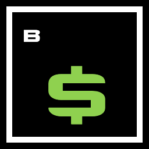
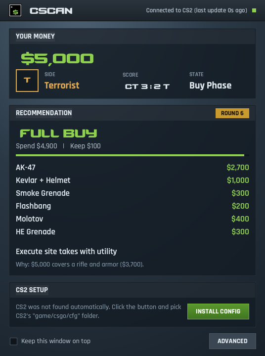

#  CSCAN — CS2 Economy Advisor

CSCAN tells you what to buy each round in Counter-Strike 2. It reads your money, side, score and gear through CS2's official Game State Integration and shows a buy recommendation that always fits your budget, with the reason behind it.

## Download

**[Get the latest version](https://github.com/freddypaniagua/cscan-releases/releases/latest)** (Windows 10/11, 64-bit)

1. Download `CSCAN-<version>-windows-x64.zip` from the link above.
2. Unzip it anywhere and run `CSCAN.exe` from inside the `CSCAN` folder. Keep the files next to it together.

Two things to expect:

- The app is not code-signed yet, so Windows may show "Windows protected your PC". Click **More info**, then **Run anyway**.
- If Windows reports a missing `VCRUNTIME140.dll` or `MSVCP140.dll`, install the Microsoft Visual C++ Redistributable (2015-2022, x64) from Microsoft.

## Setup

1. Start CSCAN.
2. Click **INSTALL CONFIG**. This writes one small file into CS2's `cfg` folder that tells the game to send its data to CSCAN on your PC.
3. Restart CS2 and join a match. The status in the top bar turns green and says "Connected to CS2".

## What it does

- Shows your money, side, score and round state as they change.
- Recommends the kind of round (full buy, force buy, eco, anti-eco, pistol round) and an exact shopping list with prices.
- Explains each call with the numbers, for example "Save: $2,050 now + $1,900 loss bonus = $3,950 next round, enough for a full buy."
- Keeps your own numbers on screen while you are dead and watching a teammate.
- Shows the result when the match ends.
- Can draw the advice on top of the game, for one-monitor setups (new in 0.10, see below).
- Tells you when a newer version is available.

## In-game overlay (new in 0.10)

If you play on one monitor, CSCAN can show the advice on top of the game, so you don't have to alt-tab in the buy phase.

1. Tick **Show overlay in game** at the bottom of the CSCAN window. It is off until you do.
2. Set CS2 to **Fullscreen Windowed** (CS2 settings > Video > Display Mode). In plain Fullscreen the game may cover the overlay.

A small see-through panel then appears in the buy phase with the decision, the shopping list and what you keep. It stays 10 seconds into the round, then fades out. At the end of a match it shows the result for a few seconds.

- **F8** shows or hides the overlay at any time, also in the middle of a round. While the overlay is on, CSCAN holds that key, so it no longer reaches the game. Pick another key, or **None**, under **ADVANCED > IN-GAME OVERLAY**.
- Position, opacity and text size are in the same place. **PREVIEW** shows the panel for a few seconds so you can place it.
- The overlay is a separate window on top of the game. It injects nothing into CS2, and it is built to let mouse clicks pass through to the game.
- Keep it off on FACEIT, ESEA and in tournaments until you have checked their rules on overlays.
- This is the overlay's first release. If it does not show over your game or gets in the way, untick the box and CSCAN works as before.

## Good to know

- **How it gets data:** Game State Integration, a feature Valve built for outside tools. CSCAN does not read or change the game's memory and injects nothing into the game.
- **Other platforms:** FACEIT, ESEA and tournaments have their own rules about helper tools. Check them before using CSCAN there.
- **Privacy:** nothing about your matches leaves your PC. On start, CSCAN asks GitHub once whether a newer version exists; you can turn that off under **ADVANCED > UPDATES**.
- **Removing it:** delete the CSCAN folder, and delete `gamestate_integration_cscan.cfg` from CS2's `game/csgo/cfg` folder.
- **Early version:** this is version 0.10. Prices are checked by hand against the in-game buy menu and can lag behind a Valve balance update.

## About this repository

This repository holds the downloads only. CSCAN's source code is not public.

CSCAN is a fan-made tool. It is not affiliated with or endorsed by Valve. Counter-Strike is a trademark of Valve Corporation. Licenses for the software and fonts CSCAN is built with are included in each download, in the `licenses` folder.
